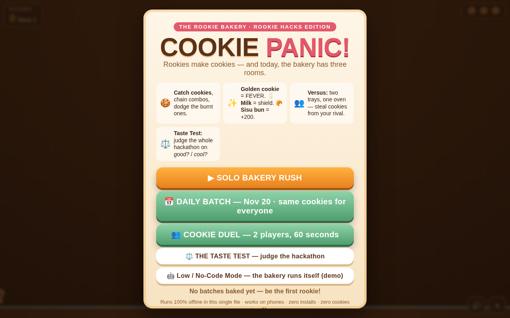
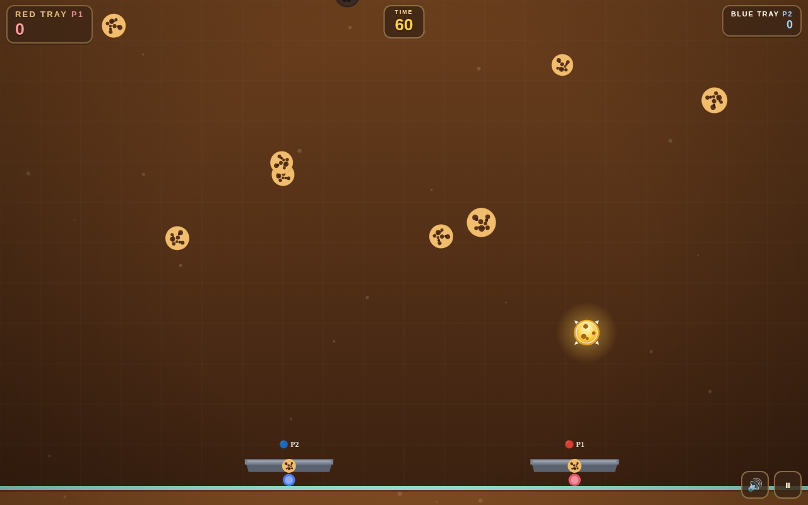
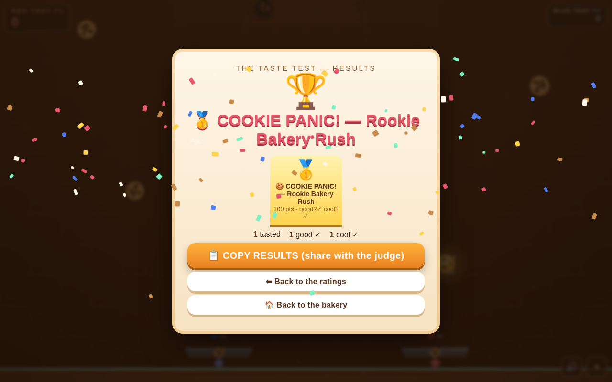

# 🍪 COOKIE PANIC! — The Rookie Bakery

**Three rooms. One HTML file. Zero dependencies.**

Built for [rookie hacks](https://rookie-hacks.devpost.com) — because *rookies make cookies*.
Open `index.html` in any browser (or the live link below) and you are the rookie on tray duty.



## The three rooms

| Room | What it is |
| --- | --- |
| 🍪 **Solo Bakery Rush** | A juicy cookie-catching arcade game. Combos, fever mode, waves, milk shields, a rare Sisu bun (+200, hello Helsinki) — and every run ends with the judge tasting your batch and rating it **good?** / **cool?** |
| 📅 **Daily Batch** | Today's challenge: a seeded oven — every player in the world gets the **exact same cookies** on the same day. Beat the daily best. |
| 👥 **Cookie Duel** | Two trays, one oven, sixty seconds. Grab a friend (or the judge) and steal each other's cookies. Split-screen touch on phones. |
| ⚖️ **The Taste Test** | The unofficial-official judging ceremony of the hackathon: add projects, taste each one on **good?** / **cool?**, run the awards — podium, medals, confetti, copyable results. |




## Engineering notes

- **One self-contained file** (~65 KB): no build step, no dependencies, no network, no assets.
- **Everything procedural**: sprites drawn with Canvas2D, all sound (catch pops, arpeggios, looping chiptune) synthesized live with WebAudio.
- **Fixed 120 Hz timestep** with accumulator; DPR-aware rendering; responsive from 375 px phones to desktops.
- **Daily Batch** uses a date-seeded [mulberry32](https://en.wikipedia.org/wiki/PRNG) PRNG — same oven for everyone, provable determinism.
- **Baker Cards**: download a shareable PNG of your run (rank, score, verdicts) from the results screen.
- **Bakery Ledger**: lifetime bakes, cookies and duels persist in localStorage.
- Reduced-motion support, pause-on-blur, keyboard/mouse/touch controls, split-touch 2P.

## Run it

- **Live**: GitHub Pages link in the repo sidebar / About section
- **Offline**: download `index.html`, double-click it. That's the whole install.

## Repo layout

```
index.html                     ← the entire bakery
media/                         ← demo video + screenshots
handout/rookie-bakery-handout.pdf  ← printable one-pager for the venue table
```

## License

MIT — bake freely.

---

*rookies make cookies* 🍪 — judged on **good?** and **cool?**
